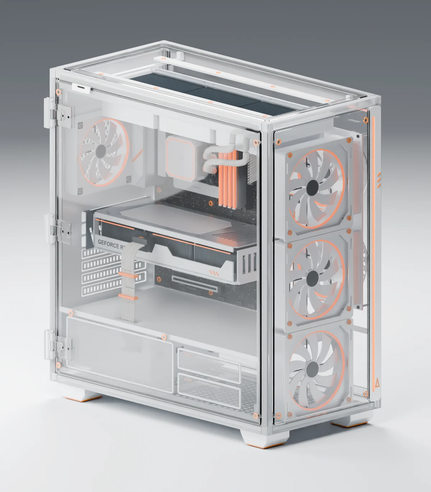
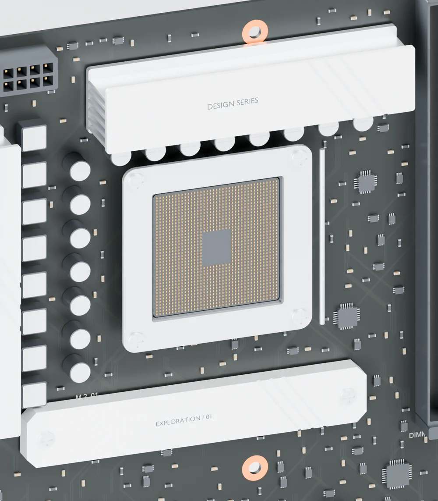
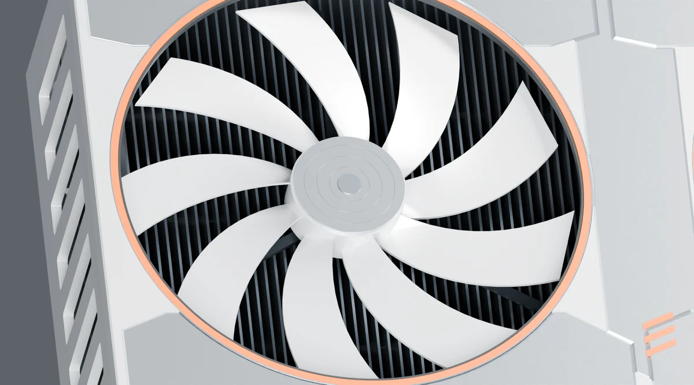
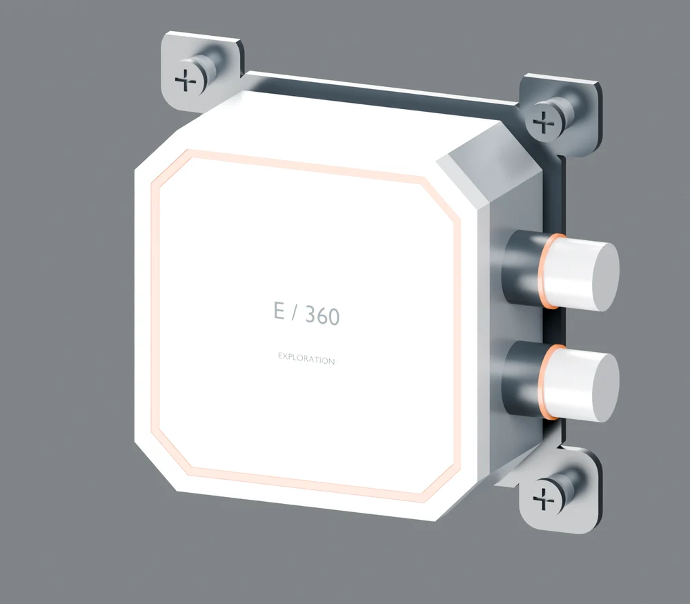

# FORM / 形构 · 产品建模交互展示

[打开在线展示](https://soliyakeitong.github.io/forma-studio-demo/) · [观看完整开场](https://soliyakeitong.github.io/forma-studio-demo/?intro=1)

从一个想法开始，让结构被构建，让产品可以被亲手探索。

| 主板 | 显卡 | 液冷 |
| --- | --- | --- |
|  |  |  |

滚动页面展开整机，拖动配件旋转，点击配件聚焦并查看内部结构。网页包含开场演示、实时 3D 装配与解构、九组独立配件和移动端布局。

本仓库保存 GitHub Pages 使用的静态发布产物，源码和完整原始 CAD 资产在独立私有仓库中管理。页面模型经过网页适配，预览图为原模型渲染。
